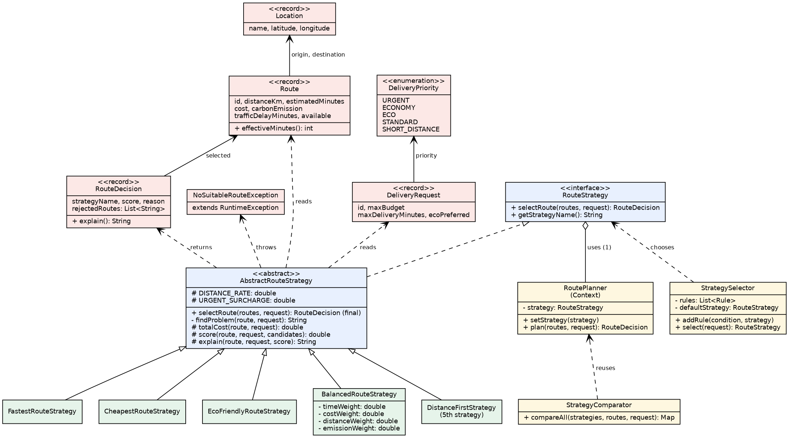
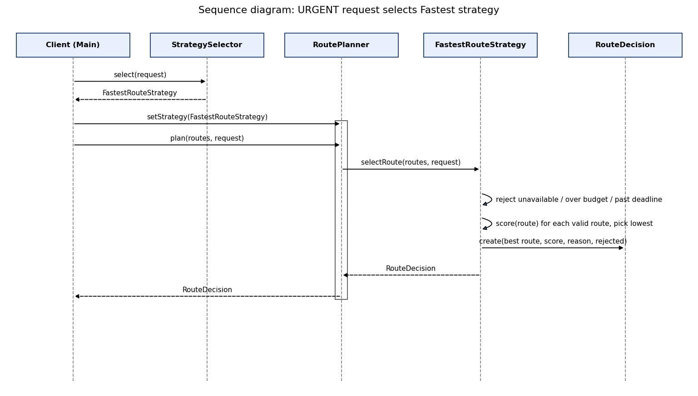

# Smart Delivery & Route Optimization Engine

## Architecture

The project has three main parts:

- **Context:** `RoutePlanner`. It holds one strategy and asks it to pick a route.
- **Strategy:** `RouteStrategy`. This is the interface that every algorithm follows.
- **Concrete strategies:** the different algorithms (Fastest, Cheapest, Eco, Balanced, DistanceFirst).

Other classes:

| Class | What it does |
|---|---|
| `StrategySelector` | Decides which strategy to use for a request |
| `StrategyComparator` | Runs all strategies on the same request |
| `AbstractRouteStrategy` | Code shared by all strategies (checks the rules, picks the best score) |
| `Route`, `DeliveryRequest`, `Location`, `DeliveryPriority` | The data |
| `RouteDecision` | The result: chosen route, reason, rejected routes |
| `NoSuitableRouteException` | Thrown when no route fits |

How one request works:

1. `StrategySelector` looks at the request and picks a strategy (for example URGENT -> Fastest).
2. `RoutePlanner` gives the work to that strategy.
3. The strategy throws out routes that break a hard rule (unavailable, too expensive, too slow).
4. It gives a score to the remaining routes and takes the lowest score.
5. It returns a `RouteDecision` that explains the choice. If no route fits, it throws `NoSuitableRouteException`.
### Formulas

| Strategy | Score (lowest wins) |
|---|---|
| Fastest | planned minutes + traffic delay |
| Cheapest | base cost + distance x 50 + (URGENT: 20% of base cost) |
| Eco | CO2 x 1.0 + distance x 0.05 |
| Balanced | weighted sum of time, cost, distance and CO2 (each scaled to 0..1). Weights must sum to 1.0 |
| DistanceFirst | distance in km |

## UML

### Class diagram



### Sequence diagram



## Answers to the questions

**1. What problem does Strategy solve in this project?**
There is no single best route. Fastest, cheapest, eco and balanced are different ways to choose. Strategy puts each way in its own class, so we do not need one big if/else.

**2. Where is the Context?**
In `RoutePlanner.java`.

**3. Where is the Strategy interface?**
In `RouteStrategy.java`.

**4. What are the Concrete Strategies?**
`FastestRouteStrategy`, `CheapestRouteStrategy`, `EcoFriendlyRouteStrategy`, `BalancedRouteStrategy` and `DistanceFirstStrategy`.

**5. Where is runtime strategy switching demonstrated?**
In `Main.java`, section 1. One `RoutePlanner` object calls `setStrategy(...)` four times and gives four different results. It is also tested in `plannerSwitchesStrategyAtRuntime`.

**6. Why is this Strategy rather than simple if/else?**
With if/else, every new algorithm means changing one big block of code, and we can break the old ones. With Strategy, each algorithm is in its own class. We can test it alone and replace it while the program runs. `RoutePlanner` has no if/else at all.

**7. How can a new Strategy be added?**
Make a new class that extends `AbstractRouteStrategy`. Write three methods: `getStrategyName()`, `score(...)` and `explain(...)`. If it should be chosen automatically, add one rule to `StrategySelector`. We did this with `DistanceFirstStrategy`, and we did not change `RoutePlanner`, `RouteStrategy` or `StrategySelector`.

**8. What is the difference between Strategy and Bridge in the context of your previous assignment?**
<!-- TODO: write about your Assignment 4 here -->
Strategy changes one algorithm. The program can swap it at any time with `setStrategy`. Bridge separates a class into two parts, the "what" (abstraction) and the "how" (implementation), so both can grow on their own. Both patterns keep a reference to an interface, but they have different goals: Strategy = choose behavior, Bridge = split two kinds of variation. In my previous assignment, ... (add your example).

**9. Which SOLID principles are demonstrated?**
- **SRP (one job per class):** `RoutePlanner` only delegates, each strategy only scores routes, `StrategySelector` only chooses a strategy.
- **OCP (open for extension):** a new strategy can be added without changing the Context or the interface.
- **DIP (depend on abstractions):** `RoutePlanner` uses the `RouteStrategy` interface, not a concrete strategy.
  **10. What limitation does your current architecture have?**
- The routes are given as data. There is no real map or route search.
- All strategies share the same hard rules (they are in the base class).
- Numbers like the distance rate (50) are written in the code, not in a settings file.
- The selector rules are checked in order, so the order matters.
- `RoutePlanner` is not safe to share between threads.

## Example console output

=== 1. RUNTIME STRATEGY SWITCHING (same planner, request #101) ===
Strategy: Fastest
Selected: Route R1
Reason: Estimated time: 25 min, traffic penalty: +8 min, final time: 33 min
Route R7 rejected: route is unavailable.

Strategy: Cheapest
Selected: Route R5
Reason: Total cost 3630 = base 2400 + distance 15.0 km x 50 = 750 + priority surcharge 480
Route R7 rejected: route is unavailable.

Strategy: Eco
Selected: Route R4
Reason: CO2: 0.9 kg, distance: 16.0 km, eco score: 1.70
Route R7 rejected: route is unavailable.

Strategy: Balanced
Selected: Route R2
Reason: Best weighted score 0.21 (time 0.40, cost 0.30, distance 0.10, emission 0.20)
Route R7 rejected: route is unavailable.

=== 2. AUTOMATIC STRATEGY SELECTION ===
Request #101 (URGENT)
Strategy: Fastest
Selected: Route R1
Reason: Estimated time: 25 min, traffic penalty: +8 min, final time: 33 min
Route R7 rejected: route is unavailable.

=== 3. STRATEGY COMPARISON MODE ===
DELIVERY REQUEST #105
Fastest Strategy:
Route R1 | Time: 33 min | Cost: 5200 | CO2: 3.9 kg | Score: 33.00
Cheapest Strategy:
Route R5 | Time: 50 min | Cost: 2400 | CO2: 2.5 kg | Score: 3150.00
Eco Strategy:
Route R4 | Time: 52 min | Cost: 3000 | CO2: 0.9 kg | Score: 1.70
Balanced Strategy:
Route R2 | Time: 36 min | Cost: 3400 | CO2: 2.0 kg | Score: 0.21
DistanceFirst Strategy:
Route R6 | Time: 48 min | Cost: 4000 | CO2: 2.8 kg | Score: 12.00

=== 4. FAILURE SCENARIOS ===
Empty list -> Route list is empty
Impossible request -> No route satisfies the constraints. Route R1 rejected: budget exceeded. Route R2 rejected: budget exceeded. Route R3 rejected: budget exceeded. Route R4 rejected: budget exceeded. Route R5 rejected: budget exceeded. Route R6 rejected: budget exceeded. Route R7 rejected: route is unavailable. Route R8 rejected: budget exceeded.
Bad weights -> Weights must sum to 1.0 but sum is 2.0
Request #102 (ECONOMY)
Strategy: Cheapest
Selected: Route R5
Reason: Total cost 3150 = base 2400 + distance 15.0 km x 50 = 750 + priority surcharge 0
Route R1 rejected: budget exceeded.
Route R2 rejected: budget exceeded.
Route R3 rejected: budget exceeded.
Route R6 rejected: budget exceeded.
Route R7 rejected: route is unavailable.

=== 3. STRATEGY COMPARISON MODE ===
DELIVERY REQUEST #105
Fastest Strategy:
Route R1 | Time: 33 min | Cost: 5200 | CO2: 3.9 kg | Score: 33.00
Cheapest Strategy:
Route R5 | Time: 50 min | Cost: 2400 | CO2: 2.5 kg | Score: 3150.00
Eco Strategy:
Route R4 | Time: 52 min | Cost: 3000 | CO2: 0.9 kg | Score: 1.70
Balanced Strategy:
Route R2 | Time: 36 min | Cost: 3400 | CO2: 2.0 kg | Score: 0.21
DistanceFirst Strategy:
Route R6 | Time: 48 min | Cost: 4000 | CO2: 2.8 kg | Score: 12.00

=== 4. FAILURE SCENARIOS ===
Empty list -> Route list is empty
Impossible request -> No route satisfies the constraints. Route R1 rejected: budget exceeded. Route R2 rejected: budget exceeded. Route R3 rejected: budget exceeded. Route R4 rejected: budget exceeded. Route R5 rejected: budget exceeded. Route R6 rejected: budget exceeded. Route R7 rejected: route is unavailable. Route R8 rejected: budget exceeded.
Bad weights -> Weights must sum to 1.0 but sum is 2.0
Request #103 (ECO)
Strategy: Eco
Selected: Route R4
Reason: CO2: 0.9 kg, distance: 16.0 km, eco score: 1.70
Route R7 rejected: route is unavailable.

=== 3. STRATEGY COMPARISON MODE ===
DELIVERY REQUEST #105
Fastest Strategy:
Route R1 | Time: 33 min | Cost: 5200 | CO2: 3.9 kg | Score: 33.00
Cheapest Strategy:
Route R5 | Time: 50 min | Cost: 2400 | CO2: 2.5 kg | Score: 3150.00
Eco Strategy:
Route R4 | Time: 52 min | Cost: 3000 | CO2: 0.9 kg | Score: 1.70
Balanced Strategy:
Route R2 | Time: 36 min | Cost: 3400 | CO2: 2.0 kg | Score: 0.21
DistanceFirst Strategy:
Route R6 | Time: 48 min | Cost: 4000 | CO2: 2.8 kg | Score: 12.00

=== 4. FAILURE SCENARIOS ===
Empty list -> Route list is empty
Impossible request -> No route satisfies the constraints. Route R1 rejected: budget exceeded. Route R2 rejected: budget exceeded. Route R3 rejected: budget exceeded. Route R4 rejected: budget exceeded. Route R5 rejected: budget exceeded. Route R6 rejected: budget exceeded. Route R7 rejected: route is unavailable. Route R8 rejected: budget exceeded.
Bad weights -> Weights must sum to 1.0 but sum is 2.0
Request #104 (STANDARD)
Strategy: Balanced
Selected: Route R2
Reason: Best weighted score 0.21 (time 0.40, cost 0.30, distance 0.10, emission 0.20)
Route R7 rejected: route is unavailable.

=== 3. STRATEGY COMPARISON MODE ===
DELIVERY REQUEST #105
Fastest Strategy:
Route R1 | Time: 33 min | Cost: 5200 | CO2: 3.9 kg | Score: 33.00
Cheapest Strategy:
Route R5 | Time: 50 min | Cost: 2400 | CO2: 2.5 kg | Score: 3150.00
Eco Strategy:
Route R4 | Time: 52 min | Cost: 3000 | CO2: 0.9 kg | Score: 1.70
Balanced Strategy:
Route R2 | Time: 36 min | Cost: 3400 | CO2: 2.0 kg | Score: 0.21
DistanceFirst Strategy:
Route R6 | Time: 48 min | Cost: 4000 | CO2: 2.8 kg | Score: 12.00

=== 4. FAILURE SCENARIOS ===
Empty list -> Route list is empty
Impossible request -> No route satisfies the constraints. Route R1 rejected: budget exceeded. Route R2 rejected: budget exceeded. Route R3 rejected: budget exceeded. Route R4 rejected: budget exceeded. Route R5 rejected: budget exceeded. Route R6 rejected: budget exceeded. Route R7 rejected: route is unavailable. Route R8 rejected: budget exceeded.
Bad weights -> Weights must sum to 1.0 but sum is 2.0
Request #107 (SHORT_DISTANCE)
Strategy: DistanceFirst
Selected: Route R6
Reason: Shortest valid distance: 12.0 km
Route R7 rejected: route is unavailable.

=== 3. STRATEGY COMPARISON MODE ===
DELIVERY REQUEST #105
Fastest Strategy:
Route R1 | Time: 33 min | Cost: 5200 | CO2: 3.9 kg | Score: 33.00
Cheapest Strategy:
Route R5 | Time: 50 min | Cost: 2400 | CO2: 2.5 kg | Score: 3150.00
Eco Strategy:
Route R4 | Time: 52 min | Cost: 3000 | CO2: 0.9 kg | Score: 1.70
Balanced Strategy:
Route R2 | Time: 36 min | Cost: 3400 | CO2: 2.0 kg | Score: 0.21
DistanceFirst Strategy:
Route R6 | Time: 48 min | Cost: 4000 | CO2: 2.8 kg | Score: 12.00

=== 4. FAILURE SCENARIOS ===
Empty list -> Route list is empty
Impossible request -> No route satisfies the constraints. Route R1 rejected: budget exceeded. Route R2 rejected: budget exceeded. Route R3 rejected: budget exceeded. Route R4 rejected: budget exceeded. Route R5 rejected: budget exceeded. Route R6 rejected: budget exceeded. Route R7 rejected: route is unavailable. Route R8 rejected: budget exceeded.
Bad weights -> Weights must sum to 1.0 but sum is 2.0

Process finished with exit code 0

## Test results

There are 23 JUnit 5 tests. They check the four strategies, switching at runtime, automatic selection, 
hard rules, budget, deadline, no valid route, wrong weights, comparison, a boundary case, failures and the 
fifth strategy.

```
[        23 tests found           ]
[        23 tests successful      ]
[         0 tests failed          ]
```
